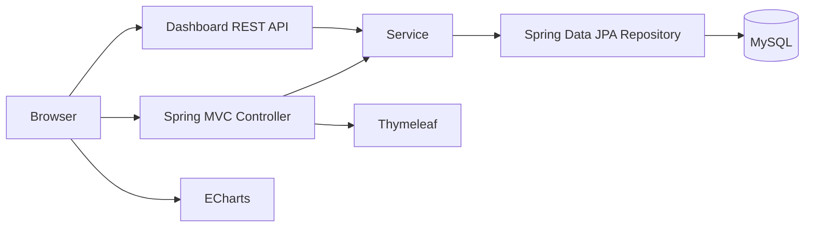

# 企業OAシステム


Spring Boot、Thymeleaf、MySQLで開発した、企業向けOA業務管理システムです。

従業員・部署・営業実績・勤怠・申請承認・公告を、役割に応じて利用する業務管理アプリケーションです。

> このリポジトリは、Spring BootとWebアプリケーション開発を学ぶための個人制作プロジェクトです。

提出範囲と検証上の制限は[段階成果](docs/MILESTONE.md)、役割別の確認順序は[操作確認ガイド](docs/ACCEPTANCE_GUIDE.md)を参照してください。
実際のDB接続情報・業務データ・管理者の秘密情報は提出物に含めません。

## 主な機能

### ログイン

- MySQLに登録されたユーザー情報によるログイン
- HTTPセッションを利用したログイン状態の保持
- ログインユーザーの氏名表示
- ログアウト処理

### 経営ダッシュボード

- 累計売上高、受注件数、新規顧客数、登録ユーザー数の表示
- 月別売上・受注推移
- 部門別売上構成
- 月別の受注件数・新規顧客数
- MySQLのデータをREST APIから取得し、EChartsで可視化

### 従業員情報管理

- 従業員一覧の表示
- 氏名、部署、役割によるリアルタイム検索
- 従業員アカウントの新規登録
- 部署、役割、アカウント状態の表示
- 管理者による所属・権限変更、有効化・論理無効化

### 勤怠・申請承認

- 出退勤・休憩打刻、履歴検索、遅刻・早退・未打刻等の判定
- 打刻修正、外勤、在宅、休暇、休日出勤、残業の申請と審査
- 管理者による勤務ルール、個別勤務予定、会社休日の設定
- 自己承認の禁止、二重審査・競合・監査障害時の更新制御

### 部署・営業実績・個人ページ

- 部署の登録、利用設定・状態の管理
- 対象月×部署の営業実績登録・版数付き編集、ダッシュボード集計
- 本人情報の参照、現在のパスワードを確認した本人パスワード変更

### お知らせ管理

- 全社員向けの社内公告、件名・本文検索、20件単位のページ送り
- 管理者・総務担当による作成・編集・公開・下書き保存
- 一般社員は有効な公開済み公告のみ参照可能
- 本人の既読登録、内容更新後の未読判定
- 版数照合、論理無効化、下書きとして復元
- jQuery AJAXによる局所更新、全更新共通のCSRFチェック

新規環境は既存SQLに続けて`src/main/resources/database/07_notices.sql`を適用します。
CSS・JavaScriptは`notices.css`・`notices.js`に分離し、jQueryは公式CDNから参照します。

## システム構成



## 使用技術

| 分類 | 技術 |
| --- | --- |
| 言語 | Java 25、HTML、CSS、JavaScript |
| フレームワーク | Spring Boot 4.1.1、Spring MVC |
| テンプレート | Thymeleaf |
| データアクセス | Spring Data JPA、Hibernate |
| データベース | MySQL 8.x |
| グラフ | Apache ECharts 6 |
| ビルド | Maven Wrapper |
| 開発環境 | Eclipse / Spring Tools |

## ディレクトリ構成

```text
src/main/java/com/example/demo/
├─ controller/     Web画面とREST API
├─ service/        業務ロジック
├─ repository/     JPAリポジトリ
├─ entity/         データベースエンティティ
└─ config/         Web設定

src/main/resources/
├─ templates/      Thymeleaf画面
├─ static/css/     画面スタイル
└─ application-example.properties
```

### 業務画面の共通レイアウト

ログイン画面と独立管理画面を除く業務画面は、次の順序で共通スタイルを読み込みます。

- `portal-layout.css`：色・寸法、ナビゲーション、共通ヘッダー、本文と狭幅レイアウト
- `portal-components.css`：見出し、カード、一覧、状態表示と共通操作部品
- 各画面のCSS：その業務だけに必要な配置・表示

ヘッダーは`fragments/portal.html`、メニューは`fragments/sidebar.html`を共有します。
`users.css`は従業員一覧専用であり、他画面から読み込みません。
`portal-navigation.js`は狭幅のメニュー開閉とフォーカスを管理し、通信や権限判定は行いません。
JavaScriptを利用できない場合も、メニューとログアウト操作を通常の文書内に表示します。

## セットアップ

### 1. リポジトリを取得

```bash
git clone https://github.com/Limbolimbs/OASystem_wu.git
cd OASystem_wu
```

### 2. データベースを作成

既存のAivenクラウドDB（`oa_system`）を使う場合、データベースの再作成は不要です。
別環境に新規構築する場合のみ、MySQLで次のデータベースを作成します。

```sql
CREATE DATABASE oa_system
  CHARACTER SET utf8mb4
  COLLATE utf8mb4_unicode_ci;
```

現行の設定は`ddl-auto=validate`です。Hibernateはテーブルを自動作成・変更しません。
既存DBの更新は[DB適用手順](src/main/resources/database/README.md)に従い、未適用のSQLだけを実行してください。
新規DBでは基礎テーブル`sys_user`・`sales_data`を用意した後、01～06を順番に適用します。

### 3. ローカル設定ファイルを作成

Windows PowerShellの場合：

```powershell
Copy-Item src/main/resources/application-example.properties `
  src/main/resources/application.properties
```

サンプル設定は環境変数`DB_URL`、`DB_USERNAME`、`DB_PASSWORD`を参照します。
Eclipseでは「Run Configurations → Environment」に3項目を設定します。
PowerShellから起動する場合は、同じターミナル内で接続情報を設定します。

```powershell
$env:DB_URL='jdbc:mysql://YOUR_DB_HOST:YOUR_DB_PORT/oa_system?sslMode=VERIFY_IDENTITY&trustCertificateKeyStoreUrl=file:D:/oa-private/project-ca.p12&trustCertificateKeyStoreType=PKCS12&trustCertificateKeyStorePassword=changeit&fallbackToSystemTrustStore=false&characterEncoding=UTF-8&connectionTimeZone=Asia/Tokyo'
$env:DB_USERNAME='YOUR_DB_USERNAME'
$env:DB_PASSWORD='YOUR_DB_PASSWORD'
```

`application.properties` はGitの管理対象外です。パスワードや秘密情報をコミットしないでください。
設定済みの非公開`application.properties`がある場合、サンプルで上書きする必要はありません。
接続先の管理画面で配布されたCAを確認し、上記の専用トラストストアを先に準備します。
`changeit`は公開CAだけを格納する容器の例示パスワードで、DBパスワードではありません。
詳細は[CAと配布設定](docs/ACCEPTANCE_GUIDE.md#接続設定とca)を参照してください。

### 4. アプリケーションを起動

Windows：

```powershell
.\mvnw.cmd spring-boot:run
```

macOS / Linux：

```bash
./mvnw spring-boot:run
```

起動後、ブラウザで [http://localhost:8080](http://localhost:8080) を開きます。

## 主なURL

| URL | 内容 |
| --- | --- |
| `/` | ログイン画面 |
| `/home` | 経営ダッシュボード |
| `/users` | 従業員一覧 |
| `/users/new` | 従業員新規登録 |
| `/departments` | 部署管理（管理者） |
| `/sales` | 営業実績管理（管理者・営業利用を許可された部署） |
| `/attendance` | 勤怠・打刻 |
| `/attendance/history` | 勤怠履歴 |
| `/attendance/manage` | 申請・審査・勤務設定 |
| `/notices` | お知らせ |
| `/my-page` | 本人情報・パスワード変更 |
| `/api/dashboard` | ダッシュボードデータAPI |

## データベーステーブル

| テーブル | 内容 |
| --- | --- |
| `sys_user` | ログイン・従業員情報 |
| `sales_data` | 月別・部門別の売上、受注、顧客データ |
| `department_master` | 部署・営業実績登録の利用設定 |

営業実績管理から売上高・受注件数・新規顧客数を入力すると、同じ `sales_data` の値をダッシュボードへ反映します。

## 部署と営業実績の運用

先に[部署・営業実績SQL](src/main/resources/database/04_sales_department.sql)を、
[DB適用手順](src/main/resources/database/README.md)に従って適用してください。自動でクラウドDBを書き換えません。
続けて[日時・論理削除共通化SQL](src/main/resources/database/05_datetime_logical_delete.sql)を適用します。
旧版の`coustomer_count`列がある環境では、[旧顧客数列の互換SQL](src/main/resources/database/06_sales_legacy_column.sql)も適用します。旧列と既存値は保持します。
全12テーブルにdelete_flag（0:有効／未削除、1:無効／論理削除）とdeleted_atを追加し、業務日時は日本時間のDATETIME(6)、画面表示はyyyy-MM-dd HH:mm:ssに統一します。
勤務日などはDATE、標準勤務時刻はTIME(0)、営業対象月はyyyy-MMを維持します。
既存日時の時差を推測して補正しません。05適用前に起動するとvalidateで追加列の不足を検出します。

1. 管理者の「部署管理」で、有効な営業部署に「営業実績登録」を許可します。営業部はSQLで初期登録されます。
2. 「従業員情報管理」の「所属更新」で営業担当社員の部署を設定します。通常は権限を「一般社員」のまま使います。
3. 営業社員のログイン後は「営業実績管理」に移動します。勤怠画面へのリンクも利用できます。
4. 対象月・売上高・受注件数・新規顧客数を照合し、「確認済み」にチェックして保存します。
5. 管理者のダッシュボードでは30秒ごと、または手動再取得で集計・3種類のグラフ・月別一覧を更新します。

実績は対象月×部署で1件です。修正は「編集」から行います。営業社員は自部署のみ、管理者は全部署を操作できます。
部署の無効化は履歴を削除せず、有効な社員が所属する場合は拒否します。版数により同時編集の上書きを防ぎます。
画面レイアウトは共通サイドバー、`portal-layout.css`・`portal-components.css`と各業務CSSを利用し、HTML・CSS・JSは別ファイルです。
ファイル取込・上長による売上承認・全変更履歴の保存は別機能であり、この月次入力には含みません。

## 今後の実装予定

- 休暇残日数管理・給与連携
- 会社管理の個人情報編集・異動履歴管理
- パスワード紛失時の再設定、CSP、外部公開時のHTTPS運用
- 監査の保存期間・アーカイブ・外部保全運用

## 操作フィードバック

`interaction-feedback.css`と`interaction-feedback.js`で、ボタンのホバー・押下・処理中表示、
画面の軽い入場、確認ダイアログの入退場と部分更新の過渡表示を共通管理します。
業務処理や通信は従来どおり各画面とjQuery AJAXが担当します。演出のために送信・画面遷移を遅らせません。
`prefers-reduced-motion`が有効な場合やページが非表示の場合は動作を抑制します。
動作が利用できない場合も画面・確認の完了・ボタン復帰を維持します。

## マイページ

全社員が`/my-page`から本人の社員番号（既存ログインIDを含む）・氏名・所属・権限・登録日時を確認できます。
会社管理項目は参照専用です。業務への入口は最新の所属・権限に応じて表示します。
サイドメニューとヘッダーのログイン者名から開けます。既存のログイン後の移動先は変更しません。

本人のパスワード変更は`POST /my-page/password`で行います。対象IDは入力値ではなく認証主体から取得します。
現在のパスワード確認は永続的なログイン試行制限を共有し、`PASSWORD_VERIFY_*`として監査します。
新しいパスワードは12～128文字・4種類中3種類以上・確認一致・現在と異なる値を検証します。
変更と監査の確定後に全会話を失効し、再ログインが必要です。失敗時に自動で再送信しません。
`my-page.html`・`my-page.css`・`my-page.js`に画面と資源を分離します。DBの追加変更は不要です。

## 非同期操作（AJAX）

画面の通信処理はjQuery 3.7.1の`$.ajax({ url, type, data, success, error })`に統一します。
`https://code.jquery.com/jquery-3.7.1.min.js`を画面の処理スクリプトより先に読み込みます。
jQueryはローカルに同梱せず、CDNを参照します。CDNに接続できる環境が必要です。
今後の同一画面内の操作もこの書式を優先します。

ログイン・ダッシュボードの既存AJAXを維持し、勤怠申請・取り下げ・審査、打刻・休憩、
勤務ルール・個別予定・会社休日、従業員登録・権限変更・有効/無効化を非同期で処理します。
勤怠検索と各一覧のページ移動は必要な領域だけを更新します。通常の画面移動はリンクで行います。

- `static/js/page-interactions.js`：送信・エラー表示・部分取得の共通処理
- `static/css/status-messages.css`：通知・処理中表示
- `data-ajax`：非同期送信フォーム、`data-ajax-targets`：更新領域のID
- POST：`success` / `message` / `redirectUrl`のJSON応答
- GET：`fragment`で指定した公開Thymeleaf断片だけを取得

入力エラー時は値を残し、他の行の審査コメントや社員検索条件も保持します。
保存済みで表示取得だけが失敗した場合は、更新を再送信せず表示のみ再取得できます。
サーバー側の権限・本人確認は従来どおり実施します。AJAX化自体にDB変更は不要ですが、部署・営業実績機能は04、全テーブル共通の日時・論理削除規約は05のSQL適用が必要です。

JavaのMVCテストは`mvnw.cmd test`、画面の回帰テストは
[AJAX画面の回帰テスト](src/test/js/README.md)を参照してください。

## 注意事項

独立したローカルHTTPS管理画面は、別のMavenアプリとして`security-console`に配置しています。
OAメニューには入口を設けず、専用認証・TOTP・CSRFで保護します。
[初期化・起動手順](security-console/README.md)に従い、10のSQLと限定DBユーザーを使用してください。
初期パスワード・認証器登録キー・DPAPI設定・PKCS12証明書を公開リポジトリへ登録しないでください。
原始IPと補助アクセス情報を表示する構成では、11の追加SQLと証跡公開鍵・独立DPAPI秘密鍵を先に配置します。
公開鍵の既定先は`D:\oa-maintenance\control-public\evidence-public.pem`です。初期設定後に業務アプリも再起動してください。
原始情報は暗号化保存し、完全なIPv4/IPv6・端末の自己申告・IP由来の推定地域/ASNを独立管理画面内で確認できます。

Spring Securityの共通認証、Argon2id、全更新CSRF、サーバー側の会話期限、永続的なログイン試行制限、重要更新と同一TXの監査を使用します。
既定値は無操作30分・認証後8時間、観測24時間内の累計失敗5回で15分、10回で60分、15回で手動解除が必要な認証保護です。送信元60要求/分は別の頻度制限です。`oa.security.*` で設定できます。
制限中は失敗加算・期限延長をせず、満了だけでは段階を戻しません。保護は観測期限でも解除しません。
保護と解除の双方で会話世代を進め、旧会話の次要求を拒否します。解除しても旧Cookieは再利用できません。
新しい保護規則の使用前に13の追加SQLを適用します。資格情報や有効状態を再生成・変更する移行ではありません。
導入時は08の移行と09の追加SQLが必要です。本番HTTPSでは `production` profileでSecure Cookieを有効にしてください。ローカルHTTPとは分離します。
DBの厳格TLSは、接続先CAを確認した`VERIFY_IDENTITY`設定を使用します。設定・証明書・環境は配布先ごとに準備します。
現在は学習用の実装です。CSP、再設定画面、監査の保存運用、脆弱性・負荷・労務の確認を含む本番導入レビューが必要です。

## 配布JARの接続設定

OAの配布JARへ、本機の`src/main/resources/application.properties`を含めません。
Eclipseの開発設定はそのまま使用できます。JAR起動時は`application-example.properties`を元に、
Git管理外の設定ファイルを用意してください。このファイル内の`${DB_URL}`等は環境変数から解決します。
外部ファイルなしで環境変数だけを使う場合は`SPRING_DATASOURCE_URL`・`SPRING_DATASOURCE_USERNAME`・
`SPRING_DATASOURCE_PASSWORD`等、Springの設定名に対応する値を設定します。`DB_URL`等だけでは接続設定になりません。
接続設定・秘密鍵を配布物へ同梱しません。

```powershell
java -jar OASystem-1-0.0.1-SNAPSHOT.jar --spring.config.additional-location=file:D:/oa-private/application.properties
```

Windowsでは、プロジェクトルートから次のスクリプトでも起動できます。指定ファイルを上書きせず、
使用中ポートを自動停止しません。スキーマは検証のみ、SQL自動初期化は無効です。

```powershell
.\scripts\start-oa.ps1 -Configuration 'D:\oa-private\application.properties'
```

設定先は例です。実際のファイルを用意し、DB接続・公開鍵・日本時間・`ddl-auto=validate`・SQL自動初期化無効を確認します。
クラウド接続には検証済みCAの専用トラストストアと`VERIFY_IDENTITY`を使用します。
`target`と保守用ビルド領域は提出しません。Git除外だけではJAR内の秘密情報除外を保証できないため、配布前に内容を確認します。
